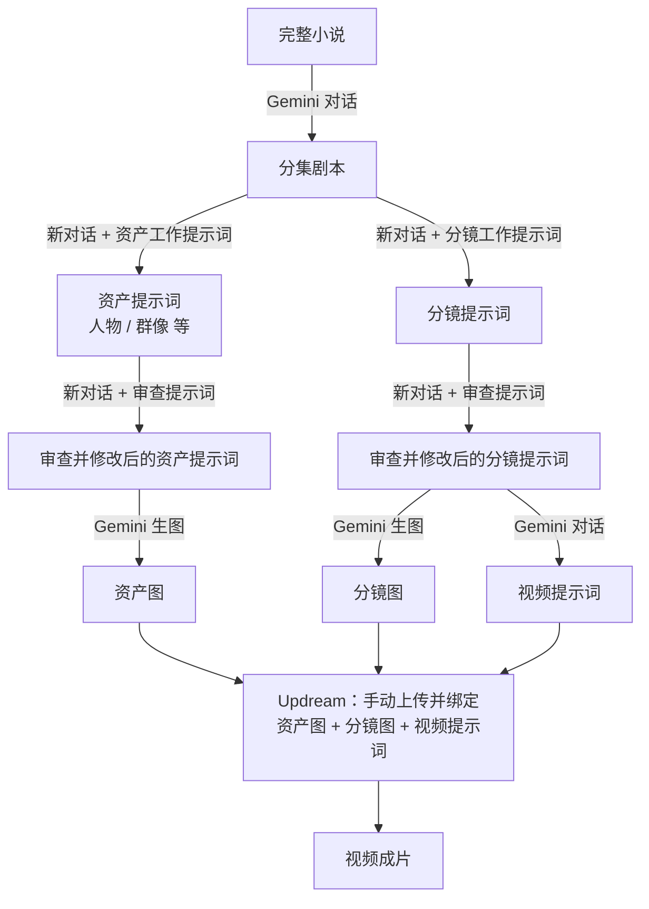
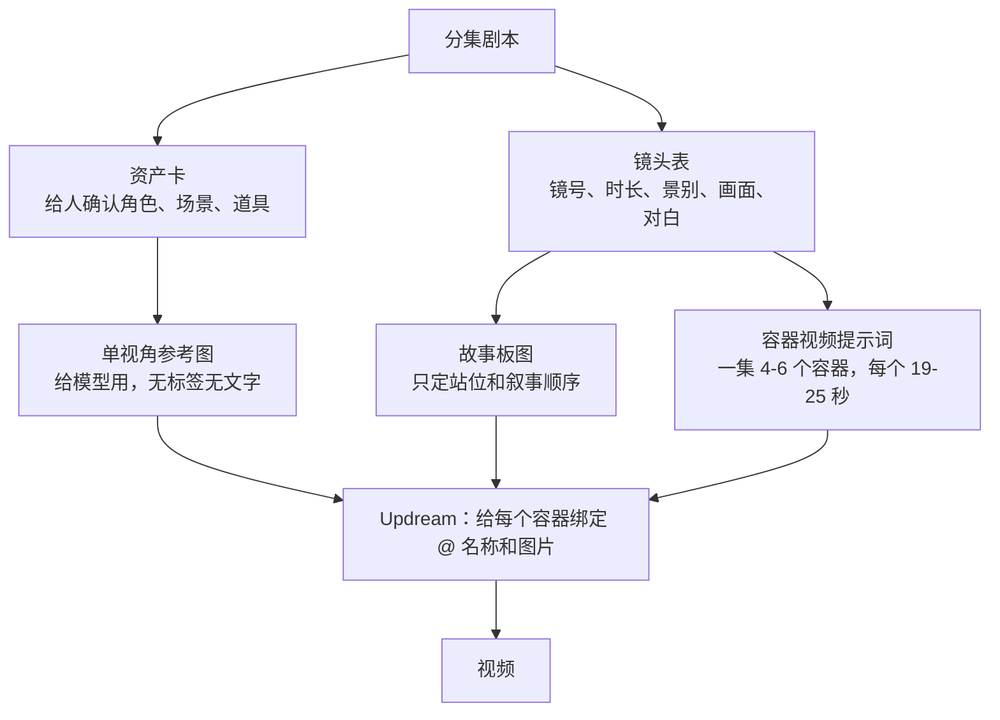

# 01 现有工作流

来源：2026-11-13 口述整理。标 ❓ 的地方是还没问清楚的细节，见[待确认问题](04-待确认问题.md)。

## 工具

- **文字和图片**：全部用 Gemini 网页版（不是 API，也不是本地 Agent）。
- **视频**：Updream（updream.cn，B 站推出的 AI 视频创作平台）。

## 流程

图中每一条箭头，现在都是一次**人工复制粘贴 + 新开对话**。写、审、改都是 AI 做的，人做的是搬运。

## 核对材料后的修正（2026-11-14）

上面的流程图来自最初的口述。对照朋友的文件后，更准确的链路是：

- 资产卡、镜头表、容器视频提示词：材料里有对应的规则。
- **镜头表到故事板图这一步，材料里没有找到提示词或做法**，待朋友补。
- @ 绑定的是资产卡还是单视角参考图，材料里没写明，待朋友确认。
- 口述里说的"分镜提示词、分镜图"，对应的应该是这里的镜头表和故事板图。

## 逐步说明

| 步骤 | 输入 | 怎么做 | 产出 |
|---|---|---|---|
| 1 切集 | 完整小说 | 在 Gemini 里切成一集一集的剧本 | 分集剧本 |
| 2 分镜提示词 | 单集剧本 | 新开对话，先喂"分镜工作提示词"，再给剧本，每集单独写 | 该集分镜提示词 |
| 3 资产提示词 | 单集剧本 | 新开对话，先喂"资产工作提示词"，再给剧本 | 人物、群像等资产提示词 |
| 4 审查 | 第 2、3 步产出 | 再新开一个 Gemini 对话，先喂"审查提示词"，把产出贴进去，由 AI 审查并修改。人只负责搬运 | 修改后的提示词 |
| 5 资产生图 | 资产提示词 | 在 Gemini 里生图 | 人物卡、群像卡等资产图 |
| 6 分镜生图 | 分镜提示词 | 在 Gemini 里生图 ❓（是否带资产图作参考） | 分镜图 |
| 7 视频提示词 | 分镜等 ❓ | 在 Gemini 里再写一份视频提示词 | 视频提示词 |
| 8 Updream成片 | 资产图 + 分镜图 + 视频提示词 | 全部手动上传到Updream，在提示词里用富文本引用的方式，把人物名称和对应图片逐个手动链接起来，再生成视频 | 成片 |

## 他手里的三套"工作提示词"

这是他这套流程的核心资产，新系统要直接继承：

1. **分镜工作提示词**：让 Gemini 按统一标准产出分镜提示词。
2. **资产工作提示词**：让 Gemini 产出有效的资产提示词。
3. **审查提示词**：检查上面两类产出的质量。

材料清点后发现，朋友给的文件和上面口述的流程对不上：资产工作提示词有三套互相矛盾的，分镜图的工作提示词和日常用的审查提示词没有找到。详见[待确认问题](04-待确认问题.md)开头。

## 分集和镜头数量：目前没有找到明确规则

在仓库里查过，结果如下：

- **怎么分集**：`references/upstream/` 里的做法是按"第 N 集"标题切，也就是照搬原稿已有的分集，没有"一集多少字"的规则。
- **原稿体量**：《萌娃心声》剧本标题覆盖第 1 到 59 集，约 10.2 万字，平均每集约 1700 字；第一集实测 1814 字。
- **一集多少镜头**：没有找到任何规则。
- **能找到的数量约定**只有资产卡一侧的：每集 6 到 14 张资产（含沿用），每集分 3 到 5 场，一个子任务处理 4 到 6 集。这些是朋友仓库里的约定，针对的是资产卡，不是分镜。

朋友自己有没有测过"一集多少字、出多少镜头"合适，需要问他 ❓。如果没有，这个数字要通过测试来定。
