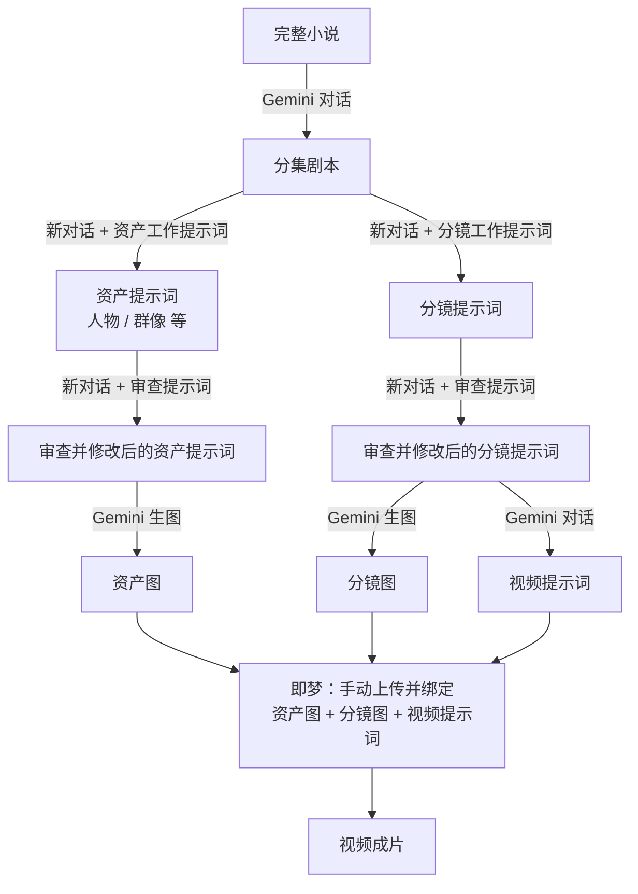

# 01 现有工作流

来源：2026-11-13 口述整理。标 ❓ 的地方是还没问清楚的细节，见[待确认问题](04-待确认问题.md)。

## 工具

- **文字和图片**：全部用 Gemini 网页版（不是 API，也不是本地 Agent）。
- **视频**：即梦 ❓（口述为"集梦"，按即梦理解，待确认）。

## 流程

图中每一条箭头，现在都是一次**人工复制粘贴 + 新开对话**。

## 逐步说明

| 步骤 | 输入 | 怎么做 | 产出 |
|---|---|---|---|
| 1 切集 | 完整小说 | 在 Gemini 里切成一集一集的剧本 | 分集剧本 |
| 2 分镜提示词 | 单集剧本 | 新开对话，先喂"分镜工作提示词"，再给剧本，每集单独写 | 该集分镜提示词 |
| 3 资产提示词 | 单集剧本 | 新开对话，先喂"资产工作提示词"，再给剧本 | 人物、群像等资产提示词 |
| 4 审查 | 第 2、3 步产出 | 再新开对话，先喂"审查提示词"，把产出贴进去审一遍，按意见修改 | 修改后的提示词 |
| 5 资产生图 | 资产提示词 | 在 Gemini 里生图 | 人物卡、群像卡等资产图 |
| 6 分镜生图 | 分镜提示词 | 在 Gemini 里生图 ❓（是否带资产图作参考） | 分镜图 |
| 7 视频提示词 | 分镜等 ❓ | 在 Gemini 里再写一份视频提示词 | 视频提示词 |
| 8 即梦成片 | 资产图 + 分镜图 + 视频提示词 | 全部手动整理上传到即梦，手动绑定文字与素材的对应关系，生成视频 | 成片 |

## 他手里的三套"工作提示词"

这是他这套流程的核心资产，新系统要直接继承：

1. **分镜工作提示词**：让 Gemini 按统一标准产出分镜提示词。
2. **资产工作提示词**：让 Gemini 产出有效的资产提示词。
3. **审查提示词**：检查上面两类产出的质量。

三套提示词的原文目前不在本仓库 ❓。
