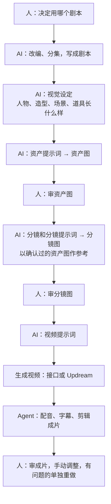

# 03 方案设想（讨论稿）

初步思路，用来对齐，不是定稿。

## 最终目标

一个封装好的 APP：把漫剧制作的整套流程做成一个智能体加一个工作台。朋友自己用，之后也可以卖给别人。

要省的成本是**人工时间**。视频模型的费用省不下来，文字生成的费用可以忽略。朋友现在大量时间花在手工操作上，这是必须省掉的。

工作台不需要很多能力，关键是**监控和审核**：人不用在多个软件之间切换，在一个 APP 里就能看到 AI 在做什么、做到哪一步，并在关键节点审核。七海画布可以作为参考。工作台跟着工作流一起建：梳理到哪个关键节点，就给那个节点做一个界面。

流水线部分有现成的开源套件可以作基础，见[开源套件 drama-skills](../references/开源套件-drama-skills.md)。

## 理想流程



人参与四处：

1. **定剧本**：决定什么剧本进入工作流。
2. **审资产图**：角色、场景长什么样由人定。它是后面所有分镜图的参考，必须先确认，否则画错的角色会被带进每个镜头。
3. **审分镜图**：镜头拆得合不合理，画面有没有问题。这一关过了才花钱出视频。
4. **审成片**：看最终成片，手动调整，有问题的部分单独重做。

人不审文字。文字环节的中间产物全部保存，只在需要追查问题出在哪一步时才回头看。

几点说明：

- **视觉设定**是剧本和提示词之间的一层，只记录事实（角色长什么样、有几套造型、场景的空间关系）。资产提示词、分镜、视频提示词都从它出发，改设定只改这一处。
- **分镜图是镜头的起始画面**，不是这一镜的插画。动作和结果交给视频提示词。
- **分集是创作决定**，由成片时长和每集结尾的钩子决定，不是按字数切。一次喂给模型多少内容是处理批次，由流水线内部处理，不需要人定。
- **声音**（配音、音效、音乐、字幕、口型）要有专门的环节。朋友现在怎么处理待确认。

## 路线

| 顺序 | 做什么 | 状态 |
|---|---|---|
| 0 | 清点朋友给的材料 | 已完成，见[材料索引](../references/材料索引.md) |
| 1 | **第一次测试**：用开源套件 drama-skills 在 Codex 里把第一集做到出图 | 待开始，见[第一次测试](05-第一次测试.md) |
| 2 | 确认出视频的方式（逐镜还是多镜合一，接口还是 Updream），在一集上跑通到成片 | |
| 3 | 把朋友的资产规则和画风要求并进来 | |
| 4 | 去掉不必要的人工确认，做到定好剧本后自动跑到出图 | |
| 5 | 工作台：给四个人工环节各做一个界面，外加进度监控 | |
| 以后 | 选题数据收集 | |

## 关于审查

1. **首选：不需要审查。** 把工作提示词优化到产出稳定。
2. **能用规则查的，用脚本查。** 比如字数、必填段落、编号、引用的资产是否存在。
3. **仍需要模型判断的，换一个模型来审。** 产出方和审查方不能是同一个模型。
4. **最终的检验是图。** 人直接审图，不审文字。

## 项目文件夹（草案）

```
项目/
├── 输入/剧本/EP001.md …        分集剧本
├── 资产/
│   ├── 资产表.json             全剧资产的唯一登记处（编号、设定、状态、采用的图）
│   └── C001-角色名/            提示词、候选图、采用图
├── 剧集/EP001/
│   ├── 分镜.json               镜头列表：画面提示词、视频提示词、引用的资产编号
│   ├── 镜头图/                 每个镜头的候选图和采用图
│   └── 视频/                   从 Updream 下载回来的素材
└── 成片/EP001/
```

分镜里记录了"这个镜头引用哪些资产编号"，注入 Updream 时的图文链接就有了数据来源，不用人再对一遍。

## 出视频的两种做法（待确认）

- **逐镜**：一个镜头一张起始图加一段视频提示词，一镜一镜生成。drama-skills 默认是这种。
- **多镜合一**：把几个镜头写进一段提示词，用 @ 引用人物和场景图，一次生成一段多镜头视频。朋友压缩包里的"多镜一体化容器提示词"和他在 Updream 里链接图片与人物名称的操作，看起来是这种。

朋友用的是哪种，决定了分镜和视频提示词部分能不能直接用开源套件。这是进入视频环节前最先要确认的事。

## 关于 Updream

查了一下公开资料（多为评测和推广文章，没有亲自验证）：Updream 是 B 站推出的 AI 视频创作平台，本身就是一个一体化工作台。它有无限画布和节点、对话式助手、可复用的 Skill 技能库（包括资产设计、分镜类的 Skill）、接入 Seedance 2.0 等视频模型、内置剪辑。

朋友选 Updream 的原因：他试过很多同类工具，Updream 做视频最便宜、效果最好，关键是它的 Seedance 2.0。所以视频生成这一步留在 Updream，我们不替换它，只解决进出它的搬运。

文字和图片为什么不在 Updream 里做，负责人判断是成本和能力的原因，细节待朋友确认。

另外，没有查到 Updream 提供公开 API。注入和下载大概率要靠浏览器自动化脚本：可行，但网页一改版就要跟着修，也要留意平台的使用条款。

## 工作台（设想）

- 按集看进度：每个资产和镜头走到哪一步。
- 审图界面：一集的资产和镜头排开，每个显示参考图和候选图，可以通过、选图或要求重出。
- 资产库：角色、场景、道具的采用图和设定。改设定后提示哪些镜头受影响。
- 审成片界面：标记有问题的片段，单独重做。
