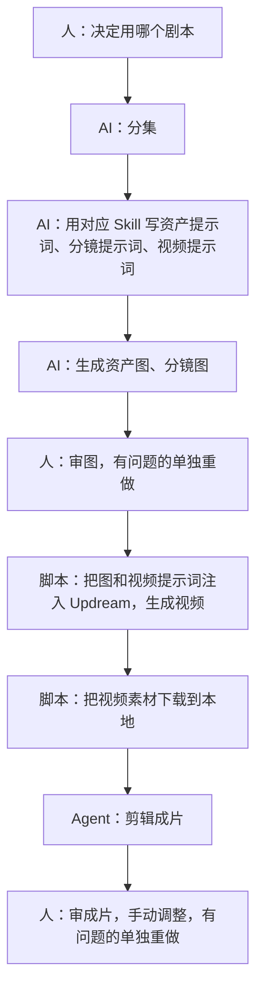

# 03 方案设想（讨论稿）

初步思路，用来对齐，不是定稿。

## 最终目标

一个封装好的 APP：把漫剧制作的整套流程做成一个智能体加一个工作台。朋友自己用，之后也可以卖给别人。

要省的成本是**人工时间**。视频模型的费用省不下来，文字生成的费用可以忽略。朋友现在大量时间花在手工操作上，这是必须省掉的。

工作台不需要很多能力，关键是**监控和审核**：人不用在多个软件之间切换，在一个 APP 里就能看到 AI 在做什么、做到哪一步，并在关键节点审核。七海画布可以作为参考。工作台跟着工作流一起建：梳理到哪个关键节点，就给那个节点做一个界面。

流水线部分有现成的开源套件可以作基础，见[开源套件 drama-skills](../references/开源套件-drama-skills.md)。

## 理想流程



人只参与三处：

1. **定剧本**：决定什么剧本进入工作流。
2. **审图**：资产图、分镜图出来后看有没有问题。
3. **审成片**：看最终成片，手动调整，有问题的部分单独拎出来重做。

人不审文字。文字环节的中间产物全部保存，只在需要追查"问题出在哪一步"时才回头看。

## 路线

| 顺序 | 做什么 | 为什么 |
|---|---|---|
| 0 | Codex 清点朋友给的全部材料，建索引 | 弄清手里到底有哪些工作提示词 |
| 1 | **第一次测试**：用朋友现有的整套逻辑和提示词，在 Codex 里走一遍第一集，出图 | 看 Codex 的结果和 Gemini 差多少，也看朋友这套思路本身有没有问题。见[第一次测试](05-第一次测试.md) |
| 2 | 优化工作提示词，改写成 Skill | 目标是产出稳定到不需要审查环节 |
| 3 | 流水线：定好剧本后一条命令跑到出图 | 解决复制粘贴和新开对话 |
| 4 | Updream 的注入和下载脚本 | 朋友的第二大痛点 |
| 5 | 剪辑 | Agent 辅助 |
| 6 | 工作台和 APP 封装 | 人审图、审成片的界面 |
| 以后 | 选题数据收集 | 有用但不关键 |

## 关于审查

1. **首选：不需要审查。** 把工作提示词优化到产出稳定。
2. **能用规则查的，用脚本查。** 比如字数、必填段落、编号、引用的资产是否存在。
3. **仍需要模型判断的，换一个模型来审。** 产出方和审查方不能是同一个模型。
4. **最终的检验是图。** 人直接审图，不审文字。

第一次测试例外：按朋友现在的做法原样保留他的审查环节，目的是看这套做法的实际效果。

## 项目文件夹（草案）

```
项目/
├── 输入/剧本/EP001.md …        分集剧本
├── 资产/
│   ├── 资产表.json             全剧资产的唯一登记处（编号、设定、状态、采用的图）
│   └── C001-角色名/            提示词、候选图、采用图
├── 剧集/EP001/
│   ├── 分镜.json               镜头列表：画面提示词、视频提示词、引用的资产编号
│   ├── 镜头图/                 每个镜头的候选图和采用图
│   └── 视频/                   从 Updream 下载回来的素材
└── 成片/EP001/
```

分镜里记录了"这个镜头引用哪些资产编号"，注入 Updream 时的图文链接就有了数据来源，不用人再对一遍。

## 关于 Updream，需要先想清楚的一件事

查了一下公开资料（多为评测和推广文章，没有亲自验证）：Updream 是 B 站推出的 AI 视频创作平台，本身就是一个一体化工作台。它有无限画布和节点、对话式助手、可复用的 Skill 技能库（包括资产设计、分镜类的 Skill）、接入 Seedance 2.0 等视频模型、内置剪辑。

朋友选 Updream 的原因：他试过很多同类工具，Updream 做视频最便宜、效果最好，关键是它的 Seedance 2.0。所以视频生成这一步留在 Updream，我们不替换它，只解决进出它的搬运。

文字和图片为什么不在 Updream 里做，负责人判断是成本和能力的原因，细节待朋友确认。

另外，没有查到 Updream 提供公开 API。注入和下载大概率要靠浏览器自动化脚本：可行，但网页一改版就要跟着修，也要留意平台的使用条款。

## 工作台（设想）

- 按集看进度：每个资产和镜头走到哪一步。
- 审图界面：一集的资产和镜头排开，每个显示参考图和候选图，可以通过、选图或要求重出。
- 资产库：角色、场景、道具的采用图和设定。改设定后提示哪些镜头受影响。
- 审成片界面：标记有问题的片段，单独重做。
